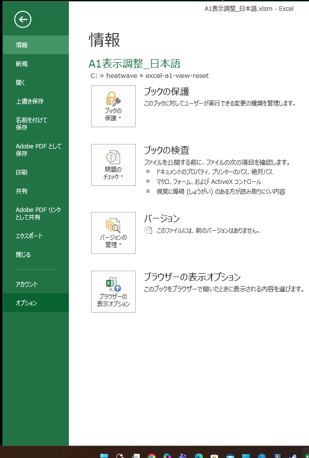
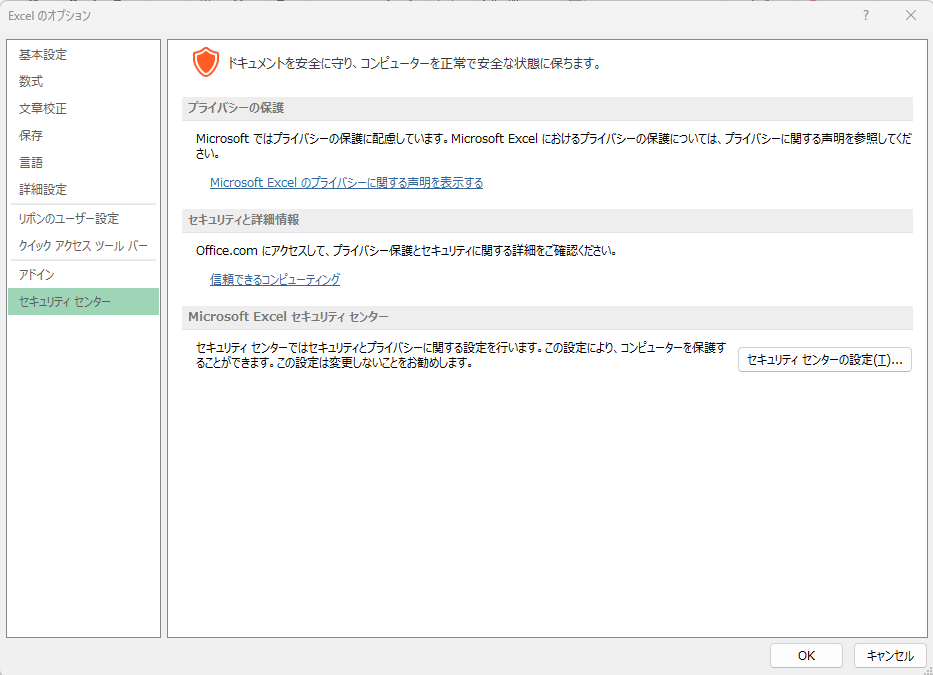
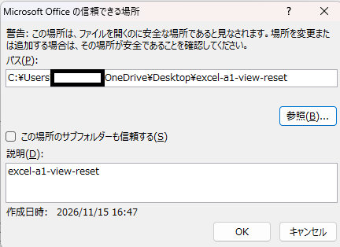
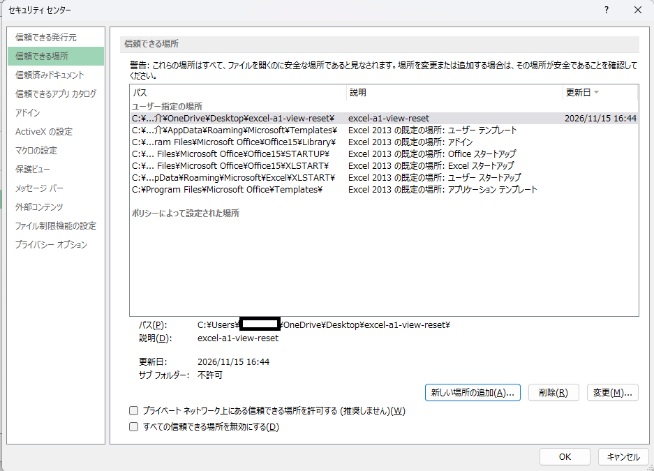

# excel-a1-view-reset

[日本語](./README.md) | **English**

An Excel VBA tool that selects cell A1 and resets the view on each worksheet in the Excel files in a specified folder.

> **This tool overwrites the original files. Always make a backup, and try it on copies first.**

## Why I Made This

I started working at a company through a staffing agency in October 2026.  
I'm in good health, and I'm fortunate to work with wonderful people. Sometimes I still find myself wondering, "Do I really belong here?"

One day on my way home from work, I found myself thinking about the past.

I realized that ever since I worked as a computer operator about 30 years ago, I've been doing the same thing after putting together Excel documents: selecting A1 on each sheet, resetting the view, and saving the file.

It's a small task, but when there are lots of files and sheets, it gets tedious, doesn't it?

At many of the places I've worked, VBA was available even when Java or Python wasn't.

So I thought I'd share a tool that does just this one thing. I hope it makes someone's work a little easier.

## Features

- Identifies Excel files directly inside the specified folder by their file extensions.
- Supports `.xlsx`, `.xlsm`, `.xls`, and `.xlsb`. Subfolders are not included.
- Displays up to 30 target filenames and the total file count before processing.
- Lets you review the list before starting. If you cancel at the confirmation step, no files are processed.
- Processes all target files after confirmation, even if there are more than 30. However, files that cannot be processed safely may be skipped.
- Works through visible worksheets from right to left, selecting A1 and resetting the scroll position to the beginning.
- Selects the leftmost visible worksheet, saves over the original file, and closes it.

## Downloads

- [Japanese macro-enabled Excel workbook](https://github.com/oouchi1234567890/excel-a1-view-reset/raw/main/A1表示調整_日本語.xlsm)
- [English macro-enabled Excel workbook](https://github.com/oouchi1234567890/excel-a1-view-reset/raw/main/A1_View_Reset_EN_v1_1.xlsm)

For normal use, open the macro-enabled workbook in your preferred language. The English version has not been execution-tested. See "Notes and Testing Status" for details.

## Before You Begin

This tool overwrites the original files. Always make a backup, and try it on copies first.

If you are using a company computer, follow your organization's policies. If running macros or changing security settings is restricted, contact your administrator.

## Preparing to Run Macros

1. If you downloaded a ZIP file, extract it first.
2. Open the macro-enabled Excel workbook (`.xlsm`).
3. Check the source and contents of the file to make sure you trust it.
4. If Excel opens the file in Protected View or displays a warning that macros are disabled, review the file and select "Enable Editing" and "Enable Content" as appropriate.

Selecting "Enable Editing" does not necessarily enable macros. Depending on your Excel version and your organization's settings, macros in files downloaded from the internet may be blocked, and "Enable Content" may not appear. If this happens, do not try to bypass the warning. Refer to [Microsoft's guidance](https://learn.microsoft.com/ja-jp/microsoft-365-apps/security/internet-macros-blocked) or contact your administrator.

## Setting Up a Trusted Location, Only If Needed

If your organization allows it, you can register a dedicated folder for this tool as a Trusted Location. This is unnecessary if the tool already works after you enable macros normally.

> Files in a Trusted Location bypass the usual security checks. Do not register your entire Desktop or Downloads folder, and keep only trusted files in the dedicated folder. You do not need to register the folder containing the files you want to process as a Trusted Location.
>
> **Changing the setting to "Enable all macros" is not recommended.**

### 1. Prepare a Dedicated Folder

Create a dedicated folder, such as "excel-a1-view-reset," and place the macro-enabled workbook you have checked and trust in it.

### 2. Open Excel Options

Open "File" → "Options."

### 3. Open the Security Settings

Select "Trust Center" and then "Trust Center Settings." Labels may differ depending on your Excel version and display language. The screenshots show the Japanese interface.

### 4. Add a Trusted Location

Select "Trusted Locations" → "Add new location." Use "Browse" to select the dedicated folder containing the macro-enabled workbook.

Leave "Subfolders of this location are also trusted" unchecked unless you need it.

The path shown in the screenshot is an example. Select the folder where you saved the tool.

### 5. Confirm the Registered Location

Check that the dedicated folder appears in the list, then click "OK" to close the settings.

## How to Use

1. Back up the Excel files you want to process.
2. Put the Excel files you want to process in the target folder.
3. Open the macro-enabled workbook and enter the folder's path in the target folder input field (B6) on the control sheet.
4. Click the Run button, labeled "実行" in the Japanese version and "Run" in the English version.
5. Review the target file list and total count, then confirm to start processing. To cancel, do so at this confirmation step.
6. Check the results when processing is complete. Review any errors or skipped files as well.

For detailed instructions and additional precautions, see the instructions sheet in the workbook or the included user guide.

## Notes and Testing Status

- Hidden worksheets are skipped and remain hidden.
- Freeze Panes settings are preserved. The scrollable area is returned to its starting position.
- Basic operation and cancellation before processing have been tested with the Japanese version in Excel 2013 on Windows. Not every file format or condition has been tested.
- An English-language macro-enabled workbook and VBA source code are also available.
- **Only the file structure and code of the English version have been checked. Compilation and execution in Excel, including operation in an English-language installation of Excel, have not been tested.**
