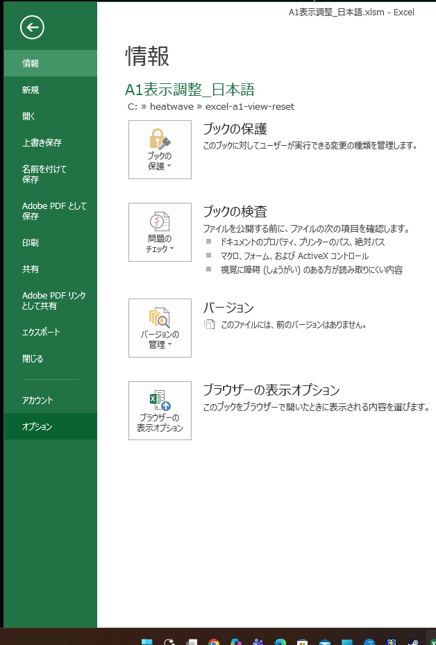
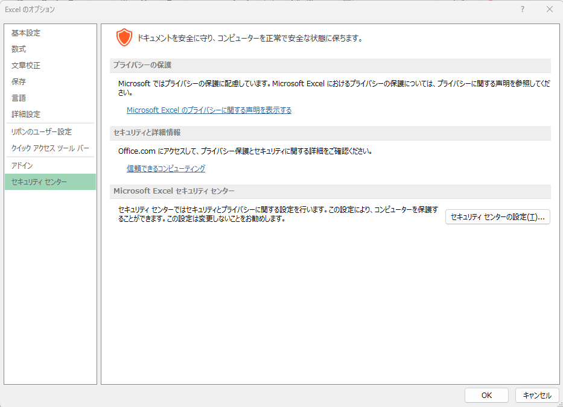
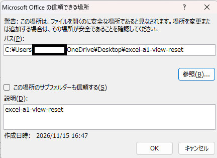
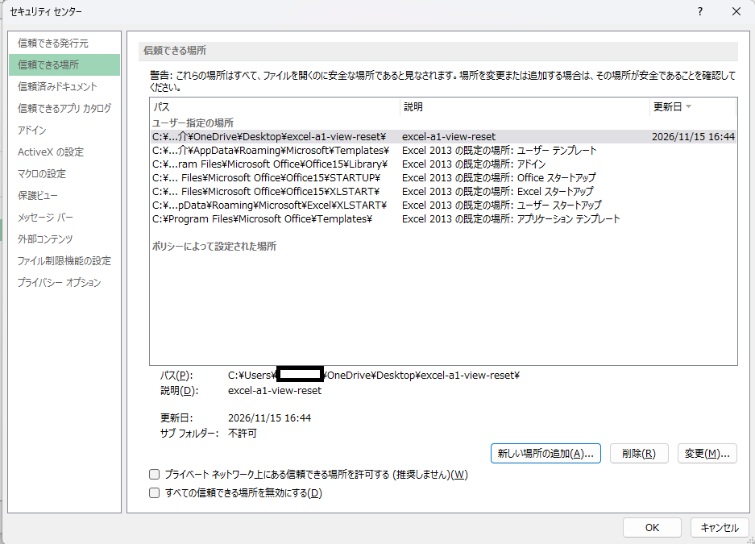

# excel-a1-view-reset

**日本語** | [English](./README.en.md)

指定したフォルダ内のExcelファイルについて、各シートの選択セルをA1に戻し、表示位置を整えるVBAツールです。

> **元のファイルを上書き保存します。必ずバックアップを取り、最初はコピーしたファイルで試してください。**

## 作ったきっかけ

2026年10月から、派遣社員として会社に勤めています。  
体調は万全です。メンバーにも恵まれて、「私がここにいていいのかな」と考えることも、たまにあります。

ある日の仕事帰り、ふと昔のことを思い出しました。

そういえば、30年ほど前にオペレーターの仕事をしていた頃から、Excelで資料をまとめた後は、各シートでA1を選択して、表示位置を整えて保存していたな、と。

一つひとつは小さな作業ですが、ファイルやシートが多いと、面倒くさいですよね。

これまでの職場では、JavaやPythonを使えない環境でも、VBAなら使えることがよくありました。

それなら、この作業だけをできるものを置いておこうと思いました。誰かの、何かの役に立ったらうれしいです。

## できること

- 指定したフォルダ直下のExcelファイルを、拡張子から判定します。
- 対象の拡張子は `.xlsx`、`.xlsm`、`.xls`、`.xlsb` です。サブフォルダは対象に含みません。
- 実行前に、対象ファイルを最大30件と総件数で表示します。
- 内容を確認してから処理を開始できます。実行前の確認でキャンセルした場合は処理しません。
- 対象が30件を超える場合も、確認後はすべての対象ファイルを処理します。ただし、安全に処理できないファイルはスキップされる場合があります。
- 表示されているワークシートを右から左へ順番に処理し、A1を選択してスクロール位置を先頭へ戻します。
- 最後に左端の表示ワークシートを選択し、上書き保存して閉じます。

## 配布ファイル

- [日本語版のマクロ入りExcelファイル](./A1表示調整_日本語.xlsm)
- [英語版のマクロ入りExcelファイル](./A1_View_Reset_EN_v1_1.xlsm)
- [日本語版VBA一式 v1.1](./Excel_A1表示調整_VBA一式_v1_1.zip)
- [英語版VBA一式 v1.1](./Excel_A1_Reset_VBA_EN_v1_1.zip)

通常は、使用したい言語のマクロ入りExcelファイルを開いて使います。英語版は実行未検証です。詳しくは「注意事項・動作確認」をご覧ください。

## 使う前に

元のファイルを上書き保存します。必ずバックアップを取り、最初はコピーしたファイルで試してください。

会社のパソコンで使う場合は、社内のルールに従ってください。マクロの実行や設定変更が制限されている場合は、管理者に確認してください。

## マクロを使うための準備

1. ZIPファイルで入手した場合は、ZIPを展開します。
2. マクロ入りのExcelファイル（`.xlsm`）を開きます。
3. 配布元と内容を確認し、信頼できるファイルであることを確かめます。
4. 「保護ビュー」やマクロが無効という警告が表示された場合は、内容を確認したうえで、必要に応じて「編集を有効にする」「コンテンツの有効化」を選びます。

「編集を有効にする」だけでは、マクロが有効になるとは限りません。Excelのバージョンや組織の設定によっては、インターネットから取得したマクロがブロックされ、「コンテンツの有効化」が表示されないことがあります。その場合は、警告を無理に回避せず、[Microsoftの案内](https://learn.microsoft.com/ja-jp/microsoft-365-apps/security/internet-macros-blocked)や管理者の指示を確認してください。

## 必要な場合だけ「信頼できる場所」を設定する

会社のルールで許可されている場合は、ツール専用フォルダを「信頼できる場所」として登録する方法もあります。通常の有効化で使える場合、この設定は不要です。

> 信頼できる場所に置いたファイルは、通常のセキュリティ確認を省いて実行されます。デスクトップ全体やダウンロードフォルダ全体は登録せず、専用フォルダには信頼できるファイルだけを置いてください。処理対象のフォルダを登録する必要はありません。
>
> **「すべてのマクロを有効にする」設定への変更はおすすめしません。**

### 1. ツール専用フォルダを用意する

「excel-a1-view-reset」などの専用フォルダを作り、確認済みのマクロ入りExcelファイルを置きます。

### 2. Excelのオプションを開く

「ファイル」→「オプション」を開きます。

### 3. セキュリティの設定画面を開く

「トラストセンター」または「セキュリティセンター」を選び、「トラストセンターの設定」または「セキュリティセンターの設定」を開きます。名称はExcelのバージョンによって異なります。

### 4. 信頼できる場所を追加する

「信頼できる場所」→「新しい場所の追加」を選びます。「参照」から、マクロ入りExcelファイルを置いた専用フォルダを指定してください。

「この場所のサブフォルダーも信頼する」は、必要がなければ選択しません。

画像のパスは設定例です。ご自身がツールを保存したフォルダを指定してください。

### 5. 登録内容を確認する

一覧に専用フォルダが追加されたことを確認し、「OK」で設定画面を閉じます。

## 使い方

1. 処理したいExcelファイルのバックアップを取ります。
2. 処理したいExcelファイルを対象フォルダに入れます。
3. マクロ入りExcelファイルを開き、操作画面の対象フォルダ入力欄（B6）にフォルダのパスを入力します。
4. 「実行」ボタンを押します。英語版のボタンは「Run」です。
5. 対象ファイルの一覧と総件数を確認して、処理を開始します。中止する場合は、この確認画面でキャンセルしてください。
6. 終了後、処理結果を確認してください。エラーやスキップがある場合は、その内容も確認します。

細かい操作や注意点は、Excelファイル内の説明シートや同梱の使い方をご覧ください。

## 注意事項・動作確認

- 非表示のシートは処理せず、非表示の状態を維持します。
- ウィンドウ枠の固定は維持し、スクロールできる領域を先頭へ戻します。
- 日本語版はWindowsのExcel 2013で、基本動作と実行前キャンセルを確認しています。すべてのファイル形式・条件を検証したものではありません。
- 英語版は、英語表示のマクロ入りExcelファイルとVBAソースを用意しています。
- **英語版ファイルは構造・コードの確認のみ実施しています。Excel上でのコンパイル・実行、および英語版Excelでの動作は未検証です。**
